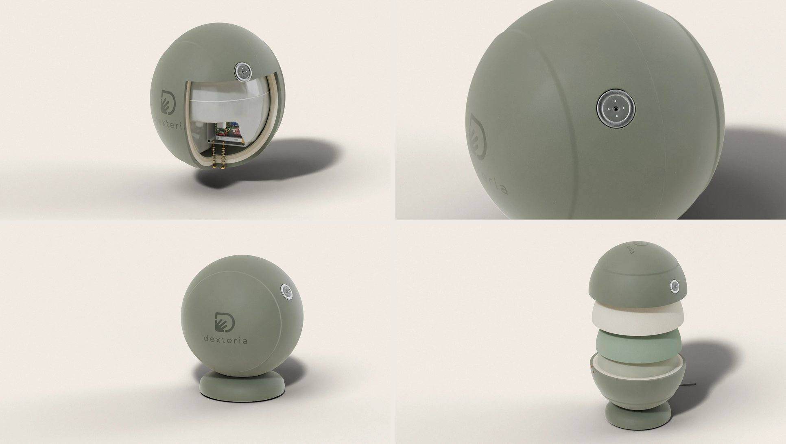
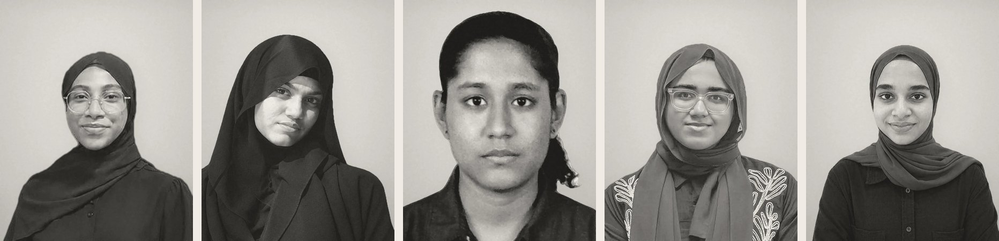

# Dexteria: Features and Team sections

Two sections of the Dexteria landing page, and everything used to make them.

- **Features**: a scroll-driven film of the Dexteria Smart Ball. Scrolling plays a 266-frame
  Blender render forwards and backwards, while each of the six product features is explained
  next to the ball, with labels pinned to the real parts inside it.
- **Team**: the five members of the Dexteria team, with portraits processed so they read as one set.

Dexteria is our Software Development Group Project (SDGP) at IIT Colombo, with the University of
Westminster. These two sections are my part of the landing page (Zaina Zayan).



---

## Contents

| Folder | What is in it |
|---|---|
| `web/components/features-v4/` | The Features section (React, CSS Modules) |
| `web/components/team-v4/` | The Team section (React, CSS Modules) |
| `web/demo/` | A small Next.js app that shows both sections, plus their assets in `public/` |
| `3d/` | The Blender model and the Python scripts that animate, render and export the film |
| `photos/scripts/` | The scripts that prepare the team portraits |
| `docs/` | Detailed documentation for each part |
| `team-export/` | Exports both sections as plain HTML for the team repository |

## Running it locally

Requirements: Node.js 18 or newer.

```bash
cd web/demo
npm install
npm run dev
```

Then open http://localhost:3030.

## Using the sections in the main site

Both sections are plain React components with CSS Modules and no other dependencies, so they work
in Next.js or in a Vite + React app.

1. Copy `web/components/features-v4/` and `web/components/team-v4/` into the site's components.
2. Copy `web/demo/public/dexteria/v51/` and `web/demo/public/team/` into the site's `public/` folder.
3. Load the Archivo font with its width axis and expose it as `--font-archivo` (see
   [docs/integration.md](docs/integration.md) for the Next.js and plain HTML versions).
4. Render them:

```jsx
<FeaturesSection framesPath="/dexteria/v51" />
<TeamSection photosPath="/team" />
```

Full steps, including what to check after merging, are in [docs/integration.md](docs/integration.md).

## How it works, briefly

**The film.** The ball was modelled in Blender and animated with Python (`bpy`). One continuous
camera move tells the six features as chapters. Every frame is rendered with Cycles at 1920 x 1080,
denoised, laid on the page colour and saved as WebP, with a square crop for phones. For every frame
Blender also exports where each part of the ball appears on screen (`anchors.json`).

**The page.** The section is tall, and a sticky canvas stays on screen while it scrolls past.
The scroll position chooses a frame, which is drawn on the canvas. Chapter text, the labels on the
parts, the charts and the buttons are ordinary HTML, CSS and SVG on top. The labels use the exported
anchor positions, so they stay on the right part in every frame.

**The team portraits.** The original photos came from different places and cameras. Each person is
cut out with Apple's Vision framework, framed by eye position so every head is the same size and
height, placed on one shared backdrop, and graded to the same warm black and white.



## Colours

Both sections use the team palette from the Dexteria logo, the same one as the other sections of
the landing page: cream `#F0ECE3`, ink `#1C281E`, sage `#5F6E5C`, light sage `#A9B8A4` and amber `#A86A28`.

## In the team repository

The full landing page is put together in [dexterialk/ATP_cs-06](https://github.com/dexterialk/ATP_cs-06),
where each section is a plain HTML file in `landing-page-components/`. To update our two sections there:

```bash
node team-export/build.mjs
```

This writes `components/features.html` and `components/team.html`, their styles in `css/`, the script
for the film in `js/`, and the frames and portraits in `images/features/` and `images/team/`.
Class names start with `dx-feat-` or `dx-team-`, so they cannot clash with other sections.
The script expects the team repository cloned into `team-repo/` next to this one.

## Documentation

- [docs/features-section.md](docs/features-section.md): how the Features section works, and how to edit its text
- [docs/3d-film.md](docs/3d-film.md): the Blender model, the film, rendering and export
- [docs/team-section.md](docs/team-section.md): editing team details and preparing new portraits
- [docs/integration.md](docs/integration.md): adding both sections to the main landing page

## Tools

All free: Blender 5.3 (Cycles), Python with NumPy and Pillow, Next.js 15 and React 19,
the Archivo typeface (Google Fonts), and Apple's Vision framework, which is built into macOS.

## Status

- All 266 frames of the film are rendered and included (about 18 MB for desktop, 8 MB for phones).
- Wording follows the team rule: "practice", "progress" and "wellness", never "therapy",
  "treatment" or "medical-grade".
- All numbers on the page (grip pressure, progress chart) are example values, labelled as such.
